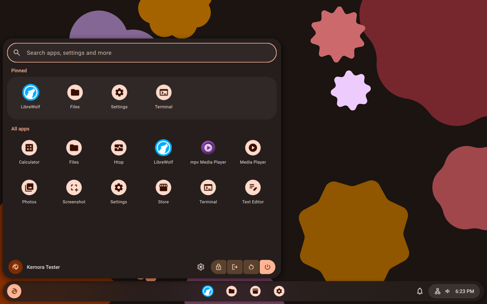
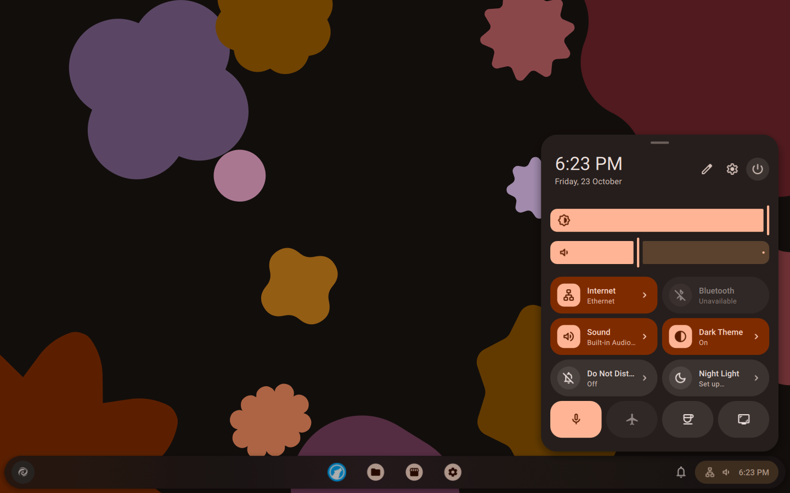
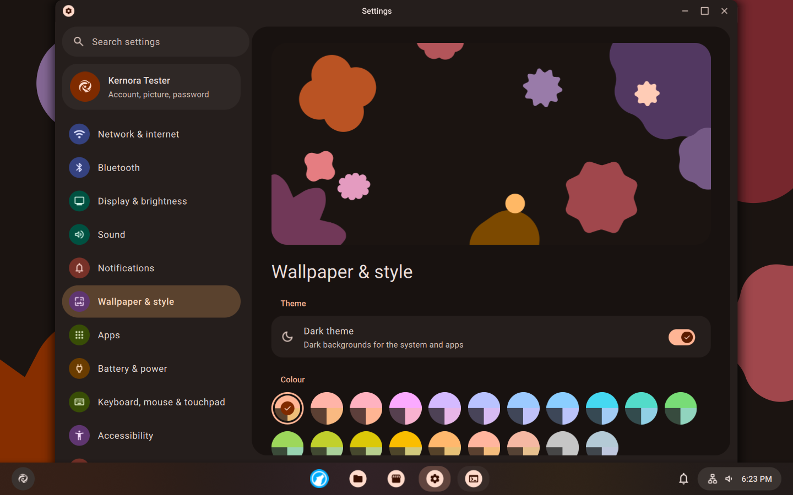
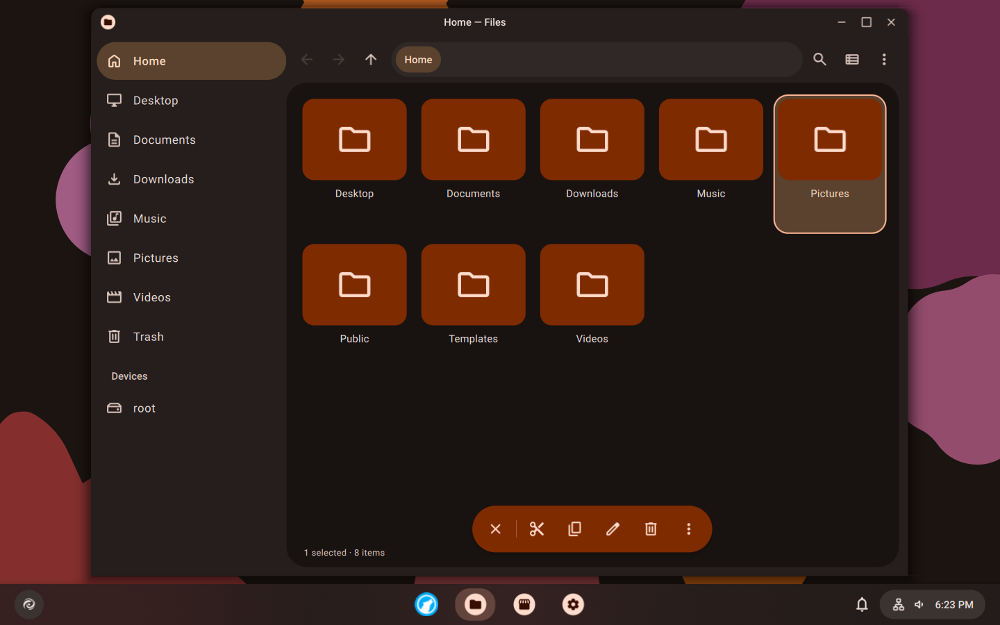
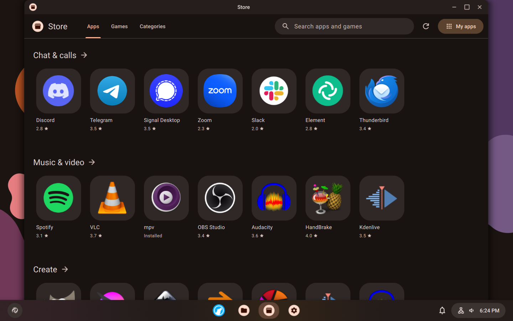
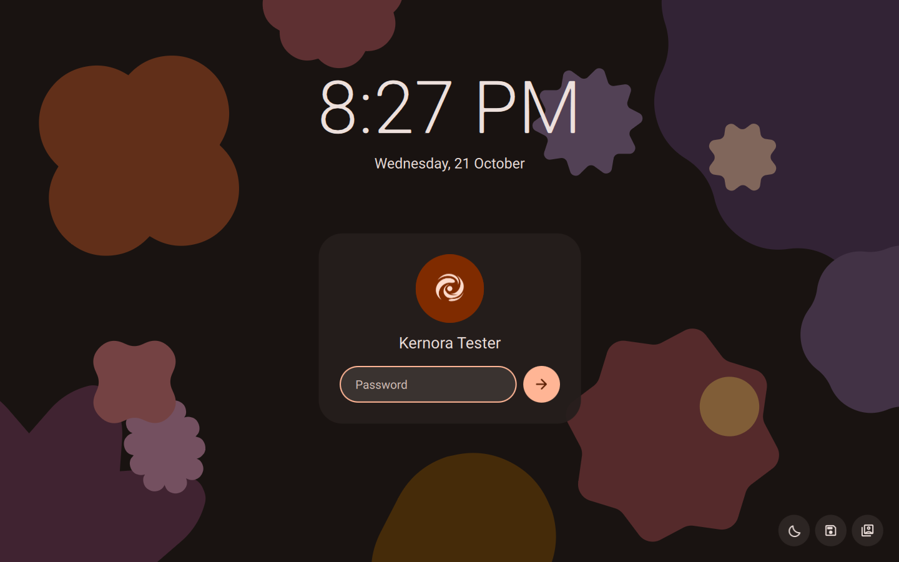

# Lumo

Lumo is a desktop Linux distribution for people coming from Windows. It is
based on Debian 13 (trixie) and runs KDE Plasma 6 with its own shell, apps and
themes, designed after Material 3.

Lumo is a fork of [Kernora OS](https://github.com/commywork9282-dotcom/Kernora-OS-)
by the Kernora Developers, under the same licence. Package, file, theme and
code names still say `kernora`; only what the user sees is called Lumo. See
`NOTICE` for the credits.

This repository has everything needed to build the live ISO: Lumo's own
packages, the changes made to a few Debian packages, the image configuration,
and the build scripts and tests.

The project is in early development. Packages are signed with a development
key for now; there is no release key yet.

If an older image leaves an installed system at a black screen, see
[boot recovery](docs/BOOT-RECOVERY.md).

Got a bug, a question or just wanna show your setup? Come hang out on
[Discord](https://discord.gg/TvxBPButVu), I post updates there and most of
the testers are there too. Issues here work as well.

- Debian 13.6 from a fixed snapshot (2026-09-01), Linux 6.12, KDE Plasma 6.3.
- A Lumo shell on top of Plasma: panel, app launcher, quick settings with an
  agenda under the clock, notifications, lock screen, Alt+Tab and power menu.
  All colours come from one seed colour, `#ff6a1e`. Settings can switch the
  look between Material Design 1, 2 and 3. Google Sans Flex is the typeface.
- Lumo apps in place of KDE's: Settings, Files, Text Editor, Photos, Media
  Player, Calculator, Screenshot, Task Manager, Calendar, Store, Terminal
  (Alacritty) and Welcome, plus a file chooser that every program uses.
- For people coming from Windows:
  - Windows shortcuts: Meta+E, Meta+I, Meta+R, Meta+Shift+S, Ctrl+Shift+Esc,
    Meta+Tab, Meta+Up/Down and more ([list](docs/DESKTOP.md#shortcuts));
  - Settings > System > Bring files from Windows copies documents, pictures,
    the wallpaper and browser bookmarks from a Windows drive or USB stick;
  - Wine opens `.exe` files; GameMode and MangoHud are installed, and Steam,
    Bottles, Lutris and Heroic are one click away in the Store;
  - Gaming Mode and Power Mode in quick settings;
  - Phone (KDE Connect): phone notifications, texts, files, the clipboard and
    Find my phone;
  - Printers & scanners that work without drivers;
  - a PIN for the lock screen.
- A Bluetooth pairing agent that shows and asks for pairing codes.
- Live wallpapers: Lumo Shapes, Tower, Rhythm, Starfall and Pastel.
- LibreWolf as the browser, from the LibreWolf repository.
- LibreOffice, Thunderbird, Okular and PDF Arranger, with fonts that keep the
  layout of Microsoft documents.
- A firewall that is on from the start, restore points around every update,
  and cloud and network folders in Files.
- Calamares as the installer, restyled to match.
- English, Dutch and Russian. The live session language is chosen in the boot
  menu.
- Updates: Debian security updates, the kernel's among them, and LibreWolf
  updates install by themselves once a day. Debian point releases and Lumo's
  own packages are offered in Settings > Updates. Lumo never restarts by
  itself. See [docs/UPDATES.md](docs/UPDATES.md).

## Screenshots

Taken in a VM with the default colour and dark theme.

<table>
  <tr>
    <td></td>
    <td></td>
  </tr>
  <tr>
    <td align="center">App launcher</td>
    <td align="center">Quick settings</td>
  </tr>
  <tr>
    <td></td>
    <td></td>
  </tr>
  <tr>
    <td align="center">Settings</td>
    <td align="center">Files, with the selection toolbar</td>
  </tr>
  <tr>
    <td></td>
    <td></td>
  </tr>
  <tr>
    <td align="center">Store</td>
    <td align="center">Lock screen</td>
  </tr>
</table>

## What's in it

- Debian 13.7 from a fixed snapshot (2026-10-15), Linux 6.12, KDE Plasma 6.3
- a Kernora shell on top of Plasma: see-through floating panel (you can make
  it solid in Settings), app launcher, quick settings, notifications, lock
  screen, Alt+Tab and power menu. Every colour comes from one seed colour,
  `#ff6a1e`, and you can switch the whole look between Material Design 1, 2
  and 3 in Settings
- Kernora apps instead of the KDE ones: Settings, Store, Files, Text Editor,
  Photos, Media Player, Calculator, Screenshot, Terminal (Alacritty) and
  Welcome, plus a file chooser every app uses
- Store for apps and games from Flathub and Debian, so you don't need the
  terminal to install stuff (see [docs/STORE.md](docs/STORE.md))
- Material 3 desktop widgets and live wallpapers: Shapes, Rhythm, Starfall
  and Pastel
- the usual terminal tools out of the box: git, curl, htop, fastfetch and co
- LibreWolf as the browser. It's not in Debian, so the build installs one
  pinned version from the LibreWolf repo and installed systems update from
  there
- NVIDIA drivers install by themselves on PCs with an NVIDIA card
  ([docs/DRIVERS.md](docs/DRIVERS.md))
- Quick Share with Android phones: send and receive files over Wi-Fi, no
  app needed on the phone ([docs/QUICKSHARE.md](docs/QUICKSHARE.md))
- Android apps (demo channel for now): turn Android on in Settings, then
  open any .apk file. Each app gets its own window
  ([docs/ANDROID.md](docs/ANDROID.md))
- Calamares as the installer, restyled to match
- English and Russian. You pick the live session language in the boot menu
- updates: Debian security updates (kernel too) and LibreWolf install by
  themselves once a day. Debian point releases and Kernora's own packages
  show up in Settings > Updates. More in [docs/UPDATES.md](docs/UPDATES.md)

KDE's standalone apps (Dolphin, Konsole, Kate, Discover, Spectacle and so on)
are left out, the list is in `configs/live/excluded-packages.txt`.

## Building

You need a Debian-based machine (Debian 13 in WSL 2 works) with:

- unprivileged user namespaces and subuid/subgid mappings (everything builds
  without root);
- `apt-get`, `dpkg-dev`, `curl`, `gpg`, `gpgv`, `mmdebstrap` and `uidmap`;
- `grub-common`, `grub-pc-bin`, `grub-efi-amd64-bin`, `xorriso`,
  `squashfs-tools` 4.7 or newer and `xz-utils` for the ISO;
- `libxml2-utils`, `libarchive-tools`, `file`, `mtools`, `gettext`,
  `reprepro`, `librsvg2-bin` and `shellcheck` for the checks;
- `qemu-system-x86` and `ovmf` for the boot tests;
- about 15 GB of free disk space.

Debian 13 ships `squashfs-tools` 4.6.1, which lacks `-numeric-owner`. Take
4.7 from Debian forky: unpack its `.deb` with `dpkg-deb -x` and put
`mksquashfs` and `unsquashfs` first in `PATH`.

Your host's APT setup isn't touched. Keyrings, tools and caches all live in
the working tree.

Fetch the sources, then build the ISO and check that it boots in QEMU (BIOS
and UEFI):

```sh
make sources
make iso-smoke
```

You get `out/iso/kernora-1-ember-live-amd64.iso` with a `.sha256` file next
to it. `make iso` builds it without the boot tests.

You can also run steps one by one, like `make local-archive` (all packages
plus the signed APT archive) or `make live-rootfs`. The `Makefile` has the
full list.

The live root file system is built in `/var/tmp`, because `/tmp` is often a
small tmpfs; set `KERNORA_TMPDIR` to use another place. The ISO build stages
its squashfs in `_build/`; set `KERNORA_SCRATCH_DIR` to stage it elsewhere.

Builds are reproducible: the Debian snapshot, tool versions and every
downloaded file are pinned by SHA-256, and archives get a fixed file order,
times and owners. Build output (`_build/`, `_cache/`, `out/`, `_state/`)
stays out of Git.

To try shell or app changes without rebuilding the whole ISO,
`scripts/preview-desktop` boots the desktop in QEMU and syncs your files
into it.

## Layout

- `packages/native/`: Lumo's own packages (`kernora-base`,
  `kernora-archive`, `kernora-desktop`, `kernora-apps`).
- `packages/derived/`: changes to Debian's `base-files`, Calamares and
  `polkit-kde-agent-1`.
- `configs/`: the upstream pins, the live image and the system identity.
- `scripts/`: build steps. `tests/`: checks for every package and image.
- `docs/`: how it all works. Start with
  [docs/ARCHITECTURE.md](docs/ARCHITECTURE.md), then
  [docs/DESKTOP.md](docs/DESKTOP.md) for the shell and design system,
  [docs/APPS.md](docs/APPS.md) for the apps,
  [docs/UPDATES.md](docs/UPDATES.md) for updates and publishing them, and
  [docs/DRIVERS.md](docs/DRIVERS.md) for the graphics drivers Lumo installs
  by itself.

## License

Lumo is released under the GNU GPL version 3 (`LICENSE`), like Kernora OS.
Its own files are GPL-2.0-or-later. `NOTICE` lists the parts that come from
others and their licences, among them Google Sans Flex (SIL OFL 1.1).
